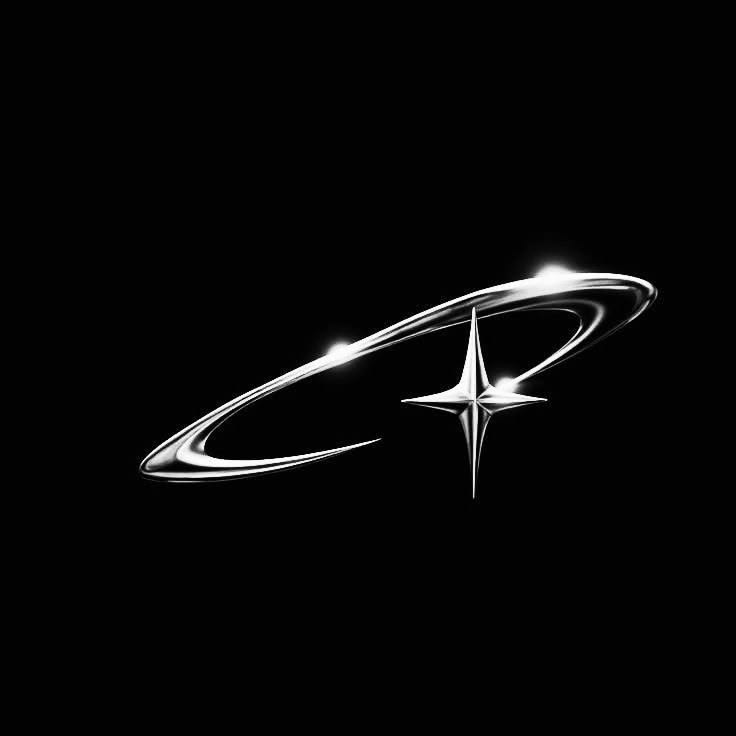
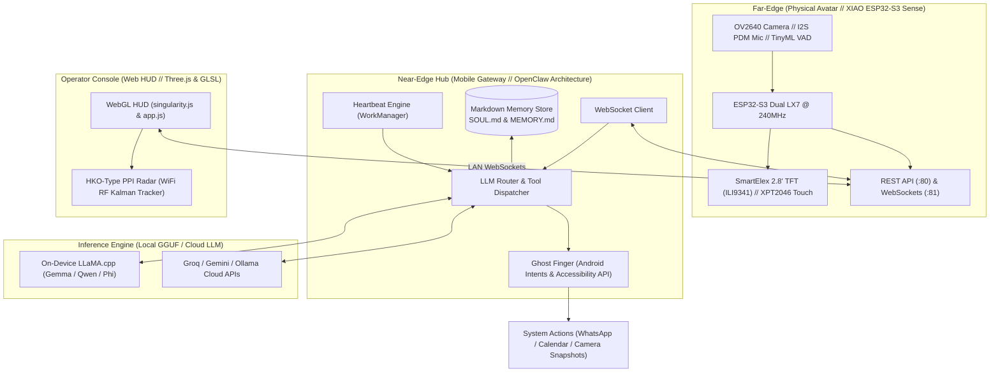
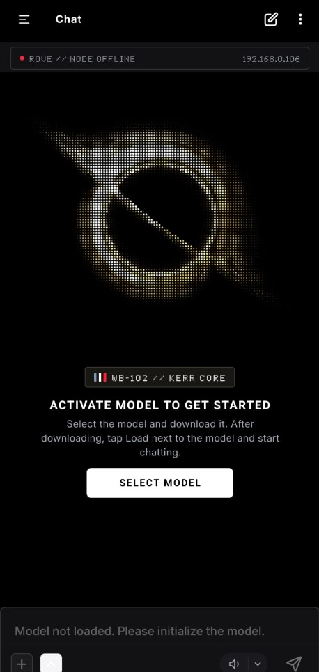
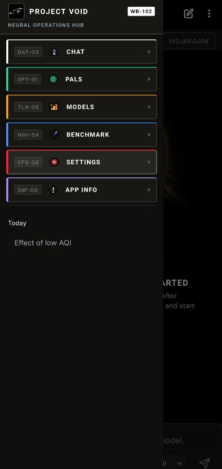
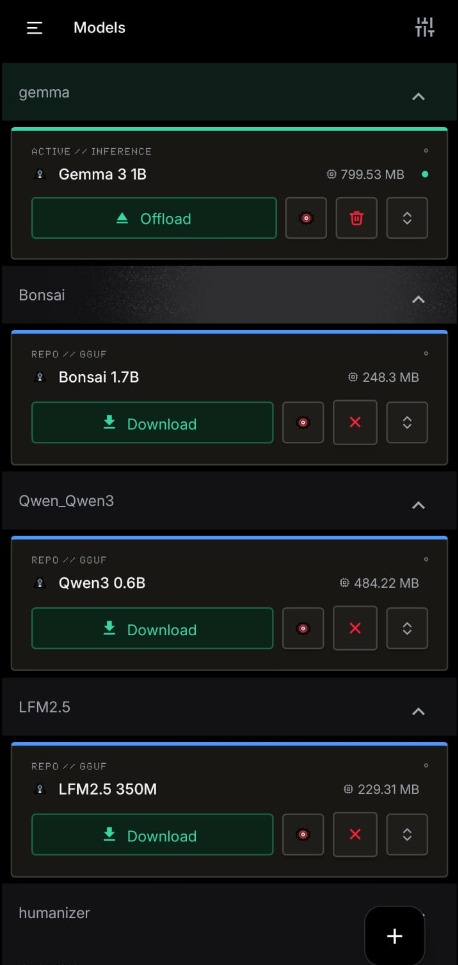
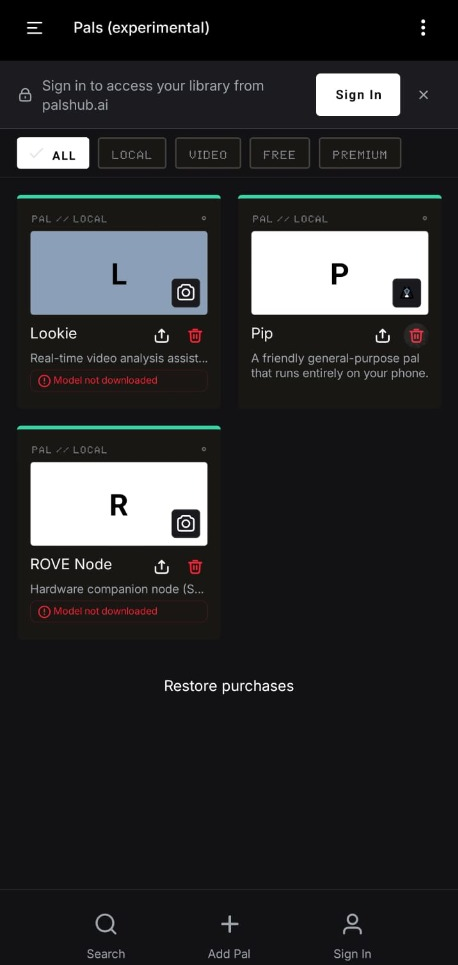
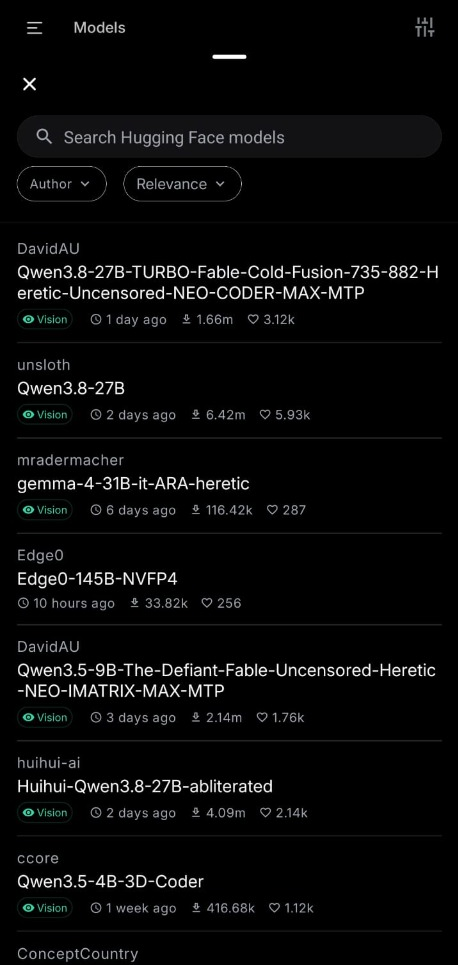

# PROJECT VOID OS // NEURAL OPERATOR & CYBER-PHYSICAL EDGE AI

<div align="center">



```
 __      __ _____  _____  _____    ____    _____ 
 \ \    / // __  \|_   _||  __ \  / __ \  / ____|
  \ \  / /| |  | |  | |  | |  | || |  | || (___  
   \ \/ / | |  | |  | |  | |  | || |  | | \___ \ 
    \  /  | |__| | _| |_ | |__| || |__| | ____) |
     \/    \____/ |_____||_____/  \____/ |_____/ 
                                                 
   V I S I O N   O P T I C S   &   I N T E G R A T E D   D I A G N O S T I C S
```

**An autonomous, multi-tier Edge-Hub-Cloud Cyber-Physical AI Companion & Neural Operator HUD.**  
*Bridging bare-metal ESP32-S3 edge avatar hardware, on-device mobile neural intelligence, and a relativistic Kerr black hole operator console.*

[](https://www.espressif.com/)
[](https://platformio.org/)
[](https://threejs.org/)
[](https://reactnative.dev/)
[](#-design-language--aesthetic-system)
[-success?style=for-the-badge&logo=android)](VOID.apk)
[](LICENSE)

</div>

---

## 📑 Table of Contents

- [Overview](#-overview)
- [System Architecture (Edge-Hub-Cloud)](#-system-architecture)
- [Key Features](#-key-features)
- [Subsystems Deep Dive](#-subsystems-deep-dive)
  - [1. VOID OS Firmware (Far-Edge Hardware Avatar)](#1-void-os-firmware-xiao-esp32-s3-sense)
  - [2. Neural Operator HUD (Web Console & WebGL Engine)](#2-neural-operator-hud-web-dashboard)
  - [3. Mobile Gateway (Near-Edge Neural Hub)](#3-mobile-gateway-on-device-private-ai)
- [Relativistic Black Hole Engine (Physics & Shader Code)](#-relativistic-black-hole-engine-physics--shader-code)
- [Compiled App & Mobile Gateway Showcase](#-compiled-app--mobile-gateway-showcase)
- [Direct APK Download & Android Installation](#-direct-apk-download--android-installation)
- [Hardware Bill of Materials & Wiring Guide](#-hardware-specifications--wiring-guide)
- [Getting Started & Installation](#-getting-started--installation)
  - [Flashing the ESP32-S3 Firmware](#1-flashing-the-firmware)
  - [Launching the Operator HUD Dashboard](#2-launching-the-web-operator-hud)
  - [Building the Mobile Gateway App](#3-building-the-mobile-app)
- [Interactive Control & API Reference](#-interactive-control--api-reference)
  - [Serial Command Interface](#serial-cli-commands-115200-baud)
  - [REST API Endpoints](#http-rest-api-endpoints-port-80)
  - [Resistive Touch Gestures](#touch-navigation-gestures-320x240-landscape)
- [Design Language & Aesthetic System](#-design-language--aesthetic-system)
- [Repository Directory Tree](#-repository-structure)
- [Roadmap](#-roadmap)
- [License](#-license)

---

## 🌌 Overview

**Project VOID OS** is a cyber-physical AI companion and telemetry operating system. Traditional AI assistants are locked inside cloud siloes and flat chat boxes. VOID breaks AI into the physical universe through a tri-layered architecture:

1. **Far-Edge Physical Avatar (ROVE Node):** Built on the **Seeed Studio XIAO ESP32-S3 Sense** microcontroller driving a **SmartElex 2.8" SPI TFT (ILI9341)** and **XPT2046 touch controller**, featuring a real-time DVP camera pipeline (OV2640/OV3660) and 16kHz I2S PDM microphone.
2. **Near-Edge Neural Hub (Android/iOS Gateway):** An on-device mobile AI runtime powered by **React Native**, **LLaMA.cpp (`llama.rn`)**, **ONNX Runtime**, and local neural TTS. Operates with an OpenClaw-inspired **Heartbeat Engine**, **Markdown Memory Store** (`SOUL.md`, `MEMORY.md`), and **Ghost Finger** intent automation.
3. **Cinematic Neural Operator HUD (WebGL Console):** A zero-dependency Node.js console rendering a ray-traced **Kerr metric relativistic black hole accretion disk** (`ghostty_blackhole.glsl` & Three.js), high-frequency bi-directional WebSockets, 16-band audio spectrum analyzer, and **HKO-Type PPI CRT radar** with WiFi RF proximity sensing.

Designed with the minimalist dot-matrix typography of **Nothing OS** (`Ndot-57`, `NType-82`), raw `#F800` Nothing Red, and iconic **Gundam RX-78-2** mobile suit livery (`#7A96B2`, `#E5A21E`, `#C86676`).

---

## 🏗️ System Architecture

Project VOID utilizes an asynchronous **Edge-Hub-Cloud Topology** designed to preserve battery, maintain local-first privacy, and provide instantaneous physical feedback:



### ⚡ Data Flow Example: "Urgent Intercept & Physical Warning"
1. **Event Capture:** An incoming notification or wake-word interrupt triggers on either the mobile hub or the XIAO board.
2. **Context Assembly:** The Mobile Gateway ingests the event, attaches persona rules from `SOUL.md`, factual history from `MEMORY.md`, and any fresh camera frame.
3. **Structured Tool Calling:** The LLM evaluates urgency in strict JSON format: `{"urgent": true, "action": "alert_user", "label": "SECURITY HAZARD"}`.
4. **Physical Dispatch:** The Gateway pushes `POST /api/alert?title=SECURITY&msg=HAZARD` across the local network to the XIAO avatar.
5. **Physical Reaction:** The ILI9341 display turns vivid mecha red, triggers an acoustic alert tone, and updates the telemetry stream across all connected Web HUD consoles.

---

## ✨ Key Features

- **🔴 7 Bare-Metal Embedded OS Modes:** Complete FreeRTOS-driven user experience on the 2.8" SPI TFT, from Gargantua core telemetry to tactical camera viewfinders and radar scopes.
- **🕳️ Binet Schwarzschild Kerr Accretion Simulation:** High-accuracy relativistic black hole physics. Includes an authentic 788-point precomputed geodesic dot-matrix on the micro-display and full GLSL fragment ray-tracing in the web console.
- **📷 Zero-Latency Direct DVP Optics Pipeline:** RGB565 frames captured straight from the OV2640/OV3660 sensor into Octal PSRAM and blasted to the ILI9341 display with hardware-swapped endianness.
- **🎙️ Real-Time 16kHz I2S Voice Scope:** Onboard PDM digital microphone streaming raw PCM audio buffers to an interactive 16-band equalizer with peak-hold dots and oscilloscope waveforms.
- **📡 WiFi RF Proximity Radar (HKO-Type PPI):** Computes physical operator distance in meters using a log-distance path loss radio model ($n=2.4$) with real-time Kalman smoothing.
- **🧠 100% Private On-Device LLM Hub:** React Native mobile gateway running GGUF models offline with hardware acceleration (Qualcomm Hexagon NPU, Adreno OpenCL, Apple Metal).
- **🕹️ Dual Control Stack:** Control via hardware resistive touch gestures, serial terminal CLI (115200 baud), or HTTP REST API endpoints.
- **🎨 Mecha Cyberpunk Aesthetic:** Custom Nothing OS dot-matrix iconography combined with authentic Gundam RX-78-2 Mobile Suit panel-line details and tri-bar livery.

---

## 🔬 Subsystems Deep Dive

### 1. VOID OS Firmware (XIAO ESP32-S3 Sense)

The embedded firmware runs directly on the ESP32-S3 dual-core microcontroller (240 MHz, 8MB PSRAM, 8MB Flash) utilizing FreeRTOS tasks to multiplex display rendering, WiFi communication, and sensor acquisition.

#### Display Modes (`enum OSMode` in [`config.h`](file:///include/config.h))

| Mode ID | Enum Constant | Operational Screen Name | Core Visuals & Capabilities |
| :---: | :--- | :--- | :--- |
| **0** | `MODE_SINGULARITY_HUD` | `// CORE HUD` | 36.5° tilted Gargantua Singularity, 32-particle vector orbital disk, live jittering telemetry flanks (`LAT`, `AZ`, `MASS`, `SPIN`), touch relativistic plasma flare. |
| **1** | `MODE_APP_DRAWER` | `// MOBILE SUIT CORES` | RX-78-2 6-card mecha interactive launcher grid with Gundam tri-bar livery (`OPT-01`, `COM-02`, `DAT-03`, `NAV-04`, `TLM-05`, `CFG-06`). |
| **2** | `MODE_TACTICAL_OPTICS` | `// OPTICS (CAM)` | Direct DVP raw camera viewfinder with tactical reticle brackets, center target crosshair, and `REC // 30.0 FPS` indicator. |
| **3** | `MODE_VOICE_COMMS` | `// VOICE SCOPE` | 16-band audio equalizer with floating peak-hold indicators, real-time 16kHz PCM oscilloscope trace, and microphone dB level monitor. |
| **4** | `MODE_AI_MESSAGES` | `// AI MESSAGES` | Tactical neural communication terminal logs, system prompt parameters, and operator prompt line. |
| **5** | `MODE_SPATIAL_RADAR` | `// SPATIAL RADAR` | HKO-Type Plan Position Indicator (PPI) phosphor CRT radar sweep with WiFi RF proximity calculations and target rings. |
| **6** | `MODE_SYSTEM_METRICS` | `// METRICS (SYS)` | Dual percentage gauges for internal SRAM (Heap) and external Octal PSRAM (8MB), WiFi RSSI dBm signal bar, IP address, and bus health indicators. |

---

### 2. Neural Operator HUD (Web Dashboard)

Located in [`dashboard/`](file:///dashboard/), this zero-dependency web interface serves as an advanced operator console accessible from any desktop or mobile browser on the local network.

- **WebGL Black Hole Engine ([`singularity.js`](file:///dashboard/singularity.js)):** Uses Three.js and custom GLSL fragment shaders derived from Binet photon acceleration formulas:
  $$a = -\frac{3}{2} \frac{h^2 \mathbf{x}}{r^5}$$
  Accurately reproduces the gravitational shadow ($b_{\text{crit}} = \frac{3\sqrt{3}}{2} r_s$), relativistic Doppler beaming, and asymmetric Keplerian accretion disk luminance.
- **RF Proximity Localizer:** Tracks operator presence using 2.4GHz WiFi RSSI variations smoothed with a 1D Kalman filter to display distance in meters on a vintage CRT phosphor scope.
- **Tactical Modals:** Includes live camera MJPEG streams, I2S voice visualizers, neural terminal chat, security lock matrix, and file storage vault.
- **Zero-Dependency Server ([`server.js`](file:///dashboard/server.js)):** Native Node.js HTTP implementation with automated local network IP discovery and MIME handling.

---

### 3. Mobile Gateway (On-Device Private AI)

Located in [`app/void/`](file:///app/void/), the mobile application acts as the "Near-Edge Brain" of the system:

- **Local Inference:** Built on React Native 0.82 with `llama.rn`, running quantized GGUF models (Gemma, Qwen, Phi-3, LLaMA) with zero cloud dependency.
- **Heartbeat Engine:** Uses Android `WorkManager` and Kotlin coroutines to execute scheduled cognitive jobs from `HEARTBEAT.md` without battery drain.
- **Dynamic Memory System:** Reads `SOUL.md` (persona/instructions) and `MEMORY.md` (append-only user fact store) before each reasoning loop.
- **Ghost Finger Executor:** Directs actions using implicit Android Intents and the Accessibility API to control apps (e.g., WhatsApp, calendar, navigation) based on tool calls returned by the LLM.

---

## 🕳️ Relativistic Black Hole Engine (Physics & Shader Code)

Project VOID features a mathematically rigorous, geodesic-traced black hole simulation modeled after the Schwarzschild metric and general relativity. Unlike games or basic visualizers that paint a static 2D texture, VOID integrates the **Binet-form photon trajectory acceleration** per pixel in real time.

### 1. General Relativity & Mathematical Derivation

In Schwarzschild spacetime, a light ray (null geodesic) orbiting a mass with Schwarzschild radius $r_s$ experiences relativistic gravitational bending governed by the Binet equation:

$$\frac{d^2 u}{d\phi^2} + u = \frac{3}{2} r_s u^2 \quad \text{where } u = \frac{1}{r}$$

Differentiating with respect to affine parameter yields the exact **Binet 3D photon acceleration** vector:

$$\mathbf{a} = -\frac{3}{2} \frac{h^2 \mathbf{x}}{r^5}$$

Where:
- $\mathbf{x}$ is the photon position relative to the singularity.
- $h = |\mathbf{x} \times \mathbf{v}|$ is the conserved specific angular momentum of the photon.
- $r = \|\mathbf{x}\|$ is the radial distance.
- Light rays with impact parameter $b < b_{\text{crit}} = \frac{3\sqrt{3}}{2} r_s \approx 2.598\, r_s$ cross the event horizon into the infinite shadow.

#### Relativistic Beaming & Shakura-Sunyaev Temperature Profile
As Keplerian gas orbits at velocity $\beta = v/c$, the received radiation is shifted by gravitational time dilation and the relativistic Doppler effect:

$$g = \frac{\sqrt{1 - \frac{1.5 r_s}{r}}}{1 - \boldsymbol{\beta} \cdot \hat{\mathbf{k}}}$$

The local effective temperature of the thin accretion disk follows the **Shakura-Sunyaev** radial profile:

$$T(r) \propto r^{-3/4} \left(1 - \sqrt{\frac{r_{\text{in}}}{r}}\right)^{1/4}$$

Observed intensity scales as $I_{\text{obs}} = g^4 I_{\text{emit}}$, producing the signature asymmetric brightness where the gas moving toward the observer shines brilliantly while receding gas dims.

---

### 2. GLSL Geodesic Ray-Tracing Shader Kernel

From [`ghostty_blackhole.glsl`](file:///ghostty_blackhole.glsl) and [`dashboard/singularity.js`](file:///dashboard/singularity.js), this symplectic leapfrog (kick-drift-kick) numerical integrator runs for each pixel:

```glsl
// ==================== NEAR FIELD: TRACE SCHWARZSCHILD GEODESIC ====================
// Parallel photon rays enter from the virtual camera at +Z towards the origin (r_s = 1)
vec3  x  = vec3(pr, Z0);              // Initial ray position (impact plane)
vec3  v  = vec3(0.0, 0.0, -1.0);       // Collimated ray velocity
float h2 = dot(pr, pr);               // Conserved specific angular momentum h^2 = |x x v|^2

vec3  emitc    = vec3(0.0);           // Accumulated accretion disk radiance (HDR)
float trans    = 1.0;                 // Transmittance through the absorbing gas
bool  captured = false;               // Event horizon crossing flag
float sPrev    = dot(x, n);           // Distance to accretion disk plane
vec3  xPrev    = x;

for (int i = 0; i < N_STEPS; i++) {
    float r2 = dot(x, x);
    if (r2 < 1.0) { captured = true; break; }  // Trapped inside event horizon (r < r_s)
    if (x.z < -Z0 && v.z < 0.0) break;         // Ray escaped out the back to infinity
    if (r2 > 4.0 * Z0 * Z0) break;             // Ray flung outward sideways

    float r  = sqrt(r2);
    // Adaptive step size: ultra-fine near photon sphere (r = 1.5 r_s), coarse far out
    float dt = clamp(0.16 * r, 0.03, 1.5);

    // Symplectic Leapfrog Integrator (Kick-Drift-Kick) preserves energy and orbit stability
    vec3 a = -1.5 * h2 * x / (r2 * r2 * r);    // Binet photon acceleration: a = -1.5 * h^2 * x / r^5
    v += a * (0.5 * dt);
    x += v * dt;
    r2 = dot(x, x);
    r  = sqrt(r2);
    a  = -1.5 * h2 * x / (r2 * r2 * r);
    v += a * (0.5 * dt);

    // ---- Thin-Disk Intersection: Ray pierced the accretion disk plane ----
    float s = dot(x, n);
    if (s * sPrev < 0.0 && trans > 0.02) {
        float tc = sPrev / (sPrev - s);
        vec3  xc = mix(xPrev, x, tc);
        float rc = length(xc);

        if (rc > rin && rc < rout) {
            // Relativistic Doppler beaming + gravitational redshift:
            // g = sqrt(1 - 1.5 / r) / (1 + beta * cos(theta))
            float gloc = sqrt(max(1.0 - 1.5 / rc, 0.02));
            vec3  gasdir = normalize(cross(n, xc)) * sdir;
            float beta   = clamp(inversesqrt(max(2.0 * (rc - 1.0), 0.2)), 0.0, 0.99);
            float g      = gloc / max(1.0 + beta * dot(gasdir, normalize(v)), 0.05);

            // Shakura-Sunyaev temperature profile mapped through blackbody radiation
            float xpr   = max(1.0 - sqrt(rin / rc), 0.0);
            float tprof = pow(rin / rc, 0.75) * pow(xpr, 0.25) / 0.488;
            vec3  color = blackbody(L.temp * tprof * g);

            // Accumulate radiative transfer with relativistic beaming intensity g^N
            float intensity = pow(g, L.beam) * L.gain;
            emitc += trans * color * intensity;
            trans *= (1.0 - L.opac);
        }
    }
    sPrev = s;
    xPrev = x;
}
```

---

### 3. Bare-Metal Microcontroller Implementation (788-Point Geodesic Matrix)

To run this simulation smoothly on the **ESP32-S3 microcontroller** with an SPI TFT without dropping frames, the geodesic points are precomputed using the exact ray-integration algorithm and mapped to a 788-point PROGMEM dot array ([`include/singularity_dots.h`](file:///include/singularity_dots.h)):

```cpp
// Precomputed Binet Schwarzschild Geodesic Ray Integration (36.5 deg relativistic tilt)
struct SingularityMatrixDot {
  int16_t x;          // Screen X coordinate (0..320)
  int16_t y;          // Screen Y coordinate (0..240)
  uint8_t size;       // Dot phosphor radius
  uint16_t baseColor; // 16-bit RGB565 Blackbody Color
  float phi;          // Geodesic orbital phase angle
  float r;            // Normalized event horizon distance
};

static const SingularityMatrixDot SINGULARITY_DOTS[788] PROGMEM = {
  {77, 56, 1, 0x6286, 2.485f, 0.475f},
  {81, 56, 1, 0x7309, 2.461f, 0.460f},
  // ... 788 authentic Schwarzschild geodesic coordinate dots ...
};
```

During runtime, [`src/display_hud.cpp`](file:///src/display_hud.cpp) animates 16 rotating orbital swirl knots around the event horizon, computing live relativistic Doppler color shifts and reacting dynamically to screen touches with energy flares.

---

## 📱 Compiled App & Mobile Gateway Showcase

The **VOID Mobile Gateway Hub** pairs your smartphone's CPU/GPU/NPU directly to the ESP32-S3 physical avatar, running quantized on-device neural models completely offline with zero cloud dependency.

<div align="center">

| 🌌 Kerr Core Hero HUD | 🛰️ Neural Operations Hub | 💬 Active Offline Chat |
| :---: | :---: | :---: |
|  |  |  |
| **Kerr Singularity Core**<br/>WB-102 Core & Status Telemetry | **Mecha Operations Drawer**<br/>DAT-03, OPT-01, TLM-05, NAV-04, CFG-06 | **On-Device Inference**<br/>Gemma 3 1B with ROVE Node Link |

| ⚙️ Active Model Manager | 🤖 ROVE Hardware Companion | 🔍 Hugging Face Explorer |
| :---: | :---: | :---: |
|  |  |  |
| **Model Quantization Engine**<br/>Active Inference, VRAM Offload & GGUF | **ROVE Companion Pals**<br/>Hardware Node Pairing & Vision AI | **Direct Model Search**<br/>1-Click GGUF Download from Hub |

</div>

### Binary Build Outputs After Compiling

When building the repository, the compiled binaries are generated at the following locations:

| Subsystem | Target Platform | Build Command | Output Binary Path |
| :--- | :--- | :--- | :--- |
| **Android App (Direct APK)** | Android Device | Download & Tap to Install | [`VOID.apk`](VOID.apk) *(also in [`dashboard/VOID.apk`](dashboard/VOID.apk))* |
| **Embedded Firmware** | XIAO ESP32-S3 Sense | `pio run` | `.pio/build/seeed_xiao_esp32s3/firmware.bin` |
| **Android App (Debug)** | Android APK | `yarn build:android` | `app/void/android/app/build/outputs/apk/prod/debug/app-prod-debug.apk` |
| **Android App (Release)**| Android AAB | `yarn build:android:release` | `app/void/android/app/build/outputs/bundle/release/app-release.aab` |
| **iOS App (Simulator)** | iOS Simulator | `yarn ios:build` | `app/void/ios/build/PocketPal.app` |
| **Web Operator HUD** | WebGL / Node.js | `node server.js` | `http://localhost:5000` (Zero compile needed) |

---

## 📥 Direct APK Download & Android Installation

No need to install Android Studio, Java, or compile from source — the production binary **[`VOID.apk`](VOID.apk)** is pre-compiled and included directly in this repository.

<div align="center">

<a href="VOID.apk">
  
</a>
<br/><br/>

| Package Specification | Details |
| :--- | :--- |
| **Package Name** | `VOID AI` / `com.pocketpal` |
| **Release Version** | `v1.21.0` |
| **Binary File** | [`VOID.apk`](VOID.apk) *(tracked via Git LFS, ~102.7 MB)* |
| **Local Mirror** | [`dashboard/VOID.apk`](dashboard/VOID.apk) *(serves offline OTA updates)* |
| **Architectures** | `arm64-v8a`, `armeabi-v7a`, `x86_64` |
| **Target OS** | Android 8.0+ (Oreo) up to Android 15 |
| **Hardware Acceleration** | Qualcomm Hexagon NPU, Adreno OpenCL GPU, multi-threaded CPU |

</div>

### Two Ways to Get the APK:

#### Method 1: Direct GitHub Download
1. Download [`VOID.apk`](VOID.apk) directly from the repository root.
2. Transfer it to your Android device via USB, or download it directly using your phone's browser.

#### Method 2: Local Network OTA Download (via Web Operator HUD)
1. Start the operator console server on your PC:
   ```bash
   cd dashboard && node server.js
   ```
2. On your Android phone, connect to the same Wi-Fi network and open `http://<your-pc-ip>:5000`.
3. Open the **RX-78-2 Application Drawer** (tap the top-right `APPS` button).
4. Tap the **`OTA-07` (DOWNLOAD VOID APK)** card to download `VOID.apk` directly over your local Wi-Fi without needing internet!

---

### 📲 Step-by-Step Installation on Android

1. **Enable Unknown Sources:**  
   Open Android **Settings** $\rightarrow$ **Security & Privacy** $\rightarrow$ **Install unknown apps**, and allow permission for your browser or file manager.
2. **Install the APK:**  
   Locate `VOID.apk` in your `Downloads` folder and tap **Install**.
3. **Grant Sensor & Connectivity Permissions:**
   - **Local Network / Wi-Fi:** Allows the app to discover and communicate with the XIAO ESP32-S3 Sense avatar over HTTP (`:80`) and WebSockets (`:81`).
   - **Camera & Microphone:** Used for the Lookie real-time video analysis assistant and offline voice interaction.
   - **Storage:** Stores downloaded GGUF neural network weights in private app storage.

---

### ⚡ 3-Minute Quickstart After Installing

1. **Launch VOID:** Open the app from your home screen or app drawer.
2. **Load a Model:**
   - Tap the top-left menu $\rightarrow$ select **Models**.
   - Download any lightweight model (e.g. `Gemma 3 1B`, `Qwen3 0.6B`, or `LFM2.5 350M`), or search any GGUF on Hugging Face.
   - Tap **Load / Inference** to activate offline chat.
3. **Pair with Physical ROVE Avatar (Optional):**
   - Tap the top-left menu $\rightarrow$ select **Settings**.
   - Enter your Seeed Studio XIAO ESP32-S3 IP address (default: `192.168.0.106`).
   - The top status pill will turn from `NODE OFFLINE` to `ROVE // LINK ONLINE`, streaming live telemetry to your avatar!

---

## 🔌 Hardware Specifications & Wiring Guide

### Component Bill of Materials (BOM)

| Component | Model / Spec | Interface | Role |
| :--- | :--- | :--- | :--- |
| **Microcontroller** | Seeed Studio XIAO ESP32-S3 Sense | Dual-core 240MHz, 8MB PSRAM, 8MB Flash | Far-Edge Avatar Processor |
| **Display Header** | SmartElex 2.8" SPI TFT (ILI9341 320x240) | Hardware SPI (HSPI / SPI3 @ 4 MHz) | Primary OS Visual HUD |
| **Touch Controller**| XPT2046 Resistive Touch Controller | Hardware SPI (Dedicated CS/MISO) | Touch Input / Gesture Surface |
| **Vision Sensor** | OV2640 / OV3660 Camera Sensor | DVP 8-bit Parallel via B2B Header | Real-Time Video Capture |
| **Audio Sensor** | MEMS PDM Digital Microphone | I2S PDM (GPIO 41 CLK, GPIO 42 DATA) | Voice & Acoustic Telemetry |

---

### Display Pinout (SmartElex 2.8" ILI9341 SPI)

Connect the display header to the XIAO ESP32-S3 headers using female-to-female jumper wires:

| Display Pin | XIAO ESP32-S3 Pin | GPIO | Function & Engineering Notes |
| :--- | :--- | :--- | :--- |
| **VCC** | **5V** | 5V | Powers the display's onboard 3.3V LDO regulator. |
| **GND** | **GND** | GND | Common ground rail. |
| **CS** | **D3** | GPIO 4 | Display SPI Chip Select. |
| **RESET** | **D1** | GPIO 2 | Hardware Reset line (firmware controlled). |
| **DC** | **D6** | GPIO 43 | Data / Command selector pin. |
| **SDI (MOSI)**| **D10** | GPIO 9 | Hardware SPI MOSI (Master Out Slave In). |
| **SCK** | **D8** | GPIO 7 | Hardware SPI Clock line. |
| **LED** | **3V3** | 3.3V | Backlight power rail. |
| **SDO (MISO)**| **DO NOT CONNECT** | — | **LEAVE DISCONNECTED!** Display is write-only. Connecting this alongside touch `T_DO` causes bus contention that can freeze the screen. |

---

### Touch Pinout (XPT2046 Touch Controller)

Connect the 5-pin `TOUCH` header on the display module:

| Touch Pin | XIAO ESP32-S3 Pin | GPIO | Function & Engineering Notes |
| :--- | :--- | :--- | :--- |
| **T_CLK** | **D8** (Shared) | GPIO 7 | Shares the SPI Clock line with the ILI9341 display. |
| **T_DIN** | **D10** (Shared)| GPIO 9 | Shares the SPI MOSI line with the ILI9341 display. |
| **T_DO** | **D9** | GPIO 8 | Dedicated Touch SPI MISO line. |
| **T_CS** | **D2** | GPIO 3 | Dedicated Touch Chip Select (Active LOW). |
| **T_IRQ** | **DO NOT CONNECT** | — | **LEAVE DISCONNECTED!** Firmware uses isolated 24-clock bitwise SPI pressure polling. Leaving `T_IRQ` disconnected eliminates signal crosstalk with the Reset line. |

---

## 🚀 Getting Started & Installation

### Prerequisites

Ensure you have the following installed on your host workstation:
- [PlatformIO Core (CLI)](https://docs.platformio.org/en/latest/core/installation/index.html) or [PlatformIO IDE for VS Code](https://platformio.org/install/ide?install=vscode)
- [Node.js](https://nodejs.org/) (v18.0.0 or higher)
- [Yarn](https://yarnpkg.com/) (v1.22+ for the mobile app)
- Android SDK & JDK 17 (if compiling the mobile app)

---

### 1. Flashing the Firmware

1. Connect the **XIAO ESP32-S3 Sense** to your computer using a USB-C data cable.
2. In the project root, run the automated flashing script:
   ```bash
   # On Linux / macOS
   chmod +x flash_xiao.sh
   ./flash_xiao.sh

   # Or manually via PlatformIO
   pio run -t upload
   ```
3. To monitor serial debug logs:
   ```bash
   pio device monitor -b 115200
   ```
> [!TIP]
> If the board fails to enter flashing mode automatically:
> 1. Hold down the **B** (Boot) button on the back of the XIAO.
> 2. Press the **R** (Reset) button once.
> 3. Release the **B** button.
> 4. Rerun `./flash_xiao.sh`.

---

### 2. Launching the Web Operator HUD

1. Open a terminal and navigate to the `dashboard` directory:
   ```bash
   cd dashboard
   ```
2. Start the zero-dependency Node server:
   ```bash
   npm start
   # or: node server.js
   ```
3. Open `http://localhost:5000` in your browser.  
   *(The server will also print your local LAN IP address, e.g., `http://192.168.x.x:5000`, so you can load the HUD onto your tablet or smartphone!)*

---

### 3. Building the Mobile App (From Source)

> [!TIP]
> **Don't want to build from source?** You can skip this step entirely and install the pre-compiled [`VOID.apk`](VOID.apk) directly on your Android phone! See the [Direct APK Installation Guide](#-direct-apk-download--android-installation) above.

1. Navigate to the mobile app folder:
   ```bash
   cd app/void
   ```
2. Install dependencies:
   ```bash
   yarn install
   ```
3. Run on Android:
   ```bash
   yarn android
   ```
4. Run on iOS (macOS required):
   ```bash
   cd ios && pod install && cd ..
   yarn ios
   ```

---

## 🕹️ Interactive Control & API Reference

### Serial CLI Commands (115200 Baud)

Open the serial monitor (`pio device monitor`) and send text commands:

| Command | Action |
| :--- | :--- |
| `hud` or `0` | Switch display to **Singularity Core HUD**. |
| `drawer` or `1` | Open the **RX-78-2 Mobile Suit Cores App Drawer**. |
| `cam` or `2` | Switch to **Tactical Optics (Camera Viewfinder)**. |
| `audio` or `3` | Switch to **Voice Scope (I2S Microphone Spectrum)**. |
| `messages` or `4` | Open **AI Neural Comms Log**. |
| `radar` or `5` | Switch to **Spatial PPI CRT Radar Scope**. |
| `metrics` or `6` | Open **System Diagnostics & Telemetry**. |
| `next` | Cycle forward to the next display screen. |
| `demo` | Toggle autonomous cycling mode (rotates screens every 4s). |
| `alert <msg>` | Trigger a full-screen tactical warning overlay banner. |
| `touch on` / `touch off` | Enable or disable physical SPI touch polling. |
| `tap flare` | Trigger a relativistic plasma energy flare on the accretion disk. |
| `tap apps` | Virtual touch tap on the top-right APPS launcher. |
| `tap home` | Virtual touch tap on the bottom gesture pill. |

---

### HTTP REST API Endpoints (Port 80)

When connected to your local Wi-Fi network (or the XIAO fallback SoftAP `VOID-OS-NODE`), the avatar exposes a REST API:

```http
# Check current system status and telemetry
GET http://<xiao-ip>/api/status
Response:
{
  "status": "ONLINE",
  "mode": 0,
  "heap_free": 268420,
  "psram_free": 7820140,
  "uptime": 128
}

# Switch display mode (0 to 6)
POST http://<xiao-ip>/api/mode?mode=2
Response: OK

# Trigger tactical alert modal
POST http://<xiao-ip>/api/alert?title=URGENT&msg=Intruder+Detected
Response: ALERT_ENGAGED

# Toggle display color inversion
GET http://<xiao-ip>/api/invert
Response: INVERT_TOGGLED
```

---

### Touch Navigation Gestures (320x240 Landscape)

```
+-------------------------------------------------------+
| [09:41]   // CORE HUD          [WIFI] [BAT]   [APPS]  | <- Top Bar (Tap APPS for Drawer)
|                                                       |
|                     ( * )                             |
|               SINGULARITY CORE                        | <- Tap Core: Relativistic Flare
|                                                       |
|                      ---                              |
+-------------------------------------------------------+
|                   [ ====== ]                          | <- Bottom Gesture Pill (Tap for Home)
+-------------------------------------------------------+
```

- **Top-Right `APPS` Button ($X \ge 270, Y \le 32$):** Opens the 6-card mecha application drawer.
- **Bottom Gesture Navigation Pill ($Y \ge 215, 100 \le X \le 220$):** Returns home to the Singularity Core from any operational mode.
- **Singularity Core Tap:** Interacting with the event horizon unleashes a radiant plasma flare across the accretion disk.
- **App Drawer Cards (3x2 Grid):** Tapping cards 1 through 6 launches the corresponding tactical subsystem.

---

## 🎨 Design Language & Aesthetic System

Project VOID fuses the raw industrial functionalism of **Nothing OS** with the military mecha architecture of **Mobile Suit Gundam RX-78-2**:

### Palette Matrix

```
[#0C0B0A] COLOR_NT_VOID        - Dark Warm Space Void
[#1C1A16] COLOR_NT_CHARCOAL    - Carbon Armor Panel Background
[#E0DCD0] COLOR_NT_WHITE       - Gundam Armor Bone-White
[#F82030] COLOR_NT_RED_VIVID   - Nothing Red Signature Glyph
[#C89018] COLOR_NT_AMBER       - RX-78-2 Collar Amber Mustard
[#7A96B2] COLOR_GUNDAM_BLUE    - RX-78-2 Torso Armor Steel Blue
[#36D6A8] COLOR_NT_MINT        - Tactical Optics Lens Mint Green
[#00CC44] COLOR_NT_GREEN       - T.A.R.S. Mono-Eye Phosphor Green
```

- **Dot-Matrix Typography:** Uses `Ndot-57` and `NType-82` for status readouts, battery pills, and telemetry readouts.
- **Blueprint Chamfers:** Tactical dialog frames feature mecha corner cutouts, panel-line rivet accents, and Gundam tri-bars (`Blue`, `Yellow`, `Red`).

---

## 📁 Repository Structure

```
VOID-main/
├── platformio.ini              # PlatformIO build configuration for XIAO ESP32-S3
├── flash_xiao.sh               # Automated bash firmware compilation & flash script
├── ghostty_blackhole.glsl      # Reference Binet Kerr null geodesic fragment shader
│
├── src/                        # Embedded C++ Firmware Source
│   ├── main.cpp                # FreeRTOS setup, loop, serial CLI & touch routing
│   └── display_hud.cpp         # 7-mode ILI9341 Nothing OS rendering engine
│
├── include/                    # Firmware Header Files
│   ├── config.h                # Pin mappings, Gundam color palette & screen modes
│   ├── display_hud.h           # DisplayHUD class declaration & animation states
│   ├── camera_module.h         # Direct DVP RGB565 OV2640 camera driver
│   ├── network_module.h        # WiFi STA/AP, REST API (:80) & WebSocket handler
│   ├── touch_module.h          # Isolated XPT2046 SPI pressure engine
│   └── singularity_dots.h      # 788-point precomputed relativistic geodesic dots
│
├── dashboard/                  # Sci-Fi Neural Operator Web Console
│   ├── index.html              # Main operator HUD layout, status bar & modals
│   ├── style.css               # Nothing OS & Gundam mecha styling rules
│   ├── app.js                  # HUD UI controller, event hooks & modal management
│   ├── esp32_client.js         # WebSocket telemetry & binary PCM audio receiver
│   ├── singularity.js          # Three.js WebGL relativistic black hole engine
│   ├── server.js               # Zero-dependency Node.js LAN server
│   └── *.otf / *.ttf           # Ndot-57 & NType-82 font assets
│
├── app/                        # Mobile Neural Gateway Hub
│   └── void/                   # React Native on-device offline LLM app
│       ├── package.json        # Dependencies (llama.rn, onnxruntime, speech)
│       └── src/                # Mobile LLM engine, memory store & tools
│
└── guide/                      # Architectural & Engineering Documentation
    ├── HLD_LLD_Architecture.md # Complete Edge-Hub-Cloud system design
    ├── specifications.md       # XIAO ESP32-S3 Sense datasheet & electrical specs
    ├── VOID_OS_XIAO_MANUAL.md  # Embedded firmware operations manual
    └── display_wiring_guide.md # Step-by-step display & touch wiring diagram
```

---

## 🗺️ Roadmap

- [x] Bare-metal FreeRTOS operating system on Seeed Studio XIAO ESP32-S3.
- [x] SmartElex 2.8" SPI TFT (ILI9341) + XPT2046 resistive touch controller integration.
- [x] Precomputed 788-point Binet Schwarzschild geodesic singularity simulation.
- [x] Zero-latency RGB565 OV2640 direct DVP camera pipeline.
- [x] WebGL Three.js operator console with real-time WebSocket telemetry.
- [x] WiFi RF proximity radar with 1D Kalman distance estimation.
- [x] On-device offline LLM mobile gateway hub with OpenClaw memory & heartbeat scheduling.
- [ ] 3D-printable mecha desktop enclosure with active servo gimbal for the avatar eye.
- [ ] Direct offline WakeNet wake-word model running via ESP-SR on Core 1.
- [ ] Stereo visual odometry and autonomous navigation via ROS2 micro-node bridging.

---

## 📜 License

This project is licensed under the **MIT License** — see the [LICENSE](LICENSE) file for details.

### Acknowledgments
- Built with open-source tools: PlatformIO, FreeRTOS, Adafruit GFX, ArduinoJson, Three.js, and React Native.
- Inspired by retro-futuristic mecha aesthetics, minimalist dot-matrix interface design, and computational general relativity research.

---

<div align="center">
  <sub>PROJECT VOID OS // BUILT FOR AUTONOMOUS EXPLORATION AND EDGE INTELLIGENCE</sub>
</div>
