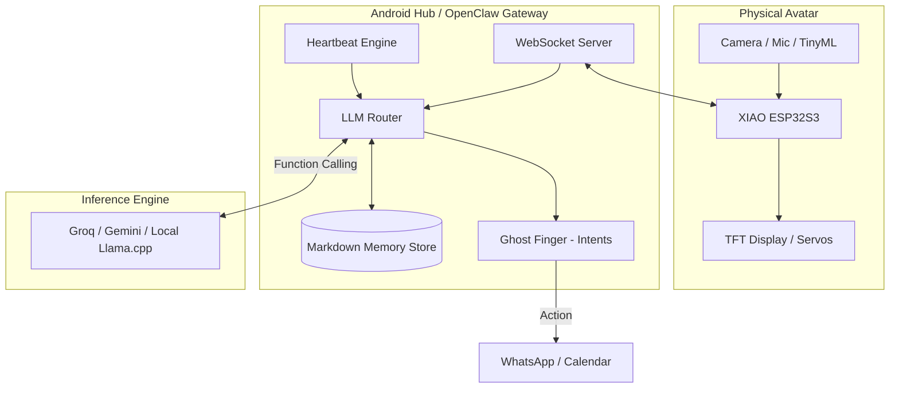

# System Architecture: J.A.R.V.I.S. OpenClaw Hybrid Agent
**Document Version:** 1.0 (HLD & LLD)

This document defines the complete High-Level Design (HLD) and Low-Level Design (LLD) for the hybrid AI agent, leveraging OpenClaw's design patterns on an Android Hub, bridged to a XIAO ESP32S3 physical avatar.

---

## Part 1: High-Level Design (HLD)

### 1.1 Architectural Overview
The system relies on an **Edge-Hub-Cloud Topology**. The Android phone acts as the "Gateway Hub," replacing the traditional Node.js OpenClaw PC server. It manages state, memory, and routing. The XIAO ESP32S3 acts as a "Hardware Node" (sensors/actuators). 

### 1.2 HLD Flow Diagram

### 1.3 Core HLD Components
1.  **Far-Edge (Physical Avatar):** The XIAO. Responsible strictly for I/O. It does no heavy reasoning. It streams data in and executes physical commands out.
2.  **Near-Edge (Android Gateway):** The OpenClaw-inspired core. It runs as an Android Foreground Service. It manages the WebSocket connections, schedules background tasks (Heartbeat), and parses user intents.
3.  **Inference Engine:** The LLM. Receives a system prompt heavily injected with the contents of the Markdown Memory Store, and returns strict JSON tool calls.

---

## Part 2: Low-Level Design (LLD)

### 2.1 The Hardware Node (XIAO ESP32S3)
*   **Protocol:** Local WebSockets (over Wi-Fi) for zero-latency, bi-directional communication.
*   **Offline Wake-Word (TinyML):** Utilizes Espressif's native **ESP-SR (WakeNet & VAD)** framework. A heavily quantized local audio model (`vadnet1`) runs continuously in a dedicated FreeRTOS task, analyzing the I2S PDM microphone offline.
*   **Event Triggering:** When ESP-SR detects the custom wake-word (e.g., "Hey JARVIS"), it triggers an interrupt. The XIAO pushes an event over the WebSocket: `{"event": "wake", "timestamp": 12345}` and begins streaming a short buffer of raw audio to the Android Hub.
*   **Command Listener:** A JSON parser (ArduinoJson) listens on the socket. If it receives `{"action": "display", "text": "Hello"}`, it renders to the ILI9341 via `TFT_eSPI`.

### 2.2 The Android Gateway (OpenClaw Core)
This is a Kotlin-based Android application utilizing modern asynchronous components.

#### 2.2.1 The Heartbeat Engine
*   **Technology:** Android `WorkManager` and Kotlin `Coroutines`.
*   **Logic:** Reads a local `HEARTBEAT.md` file (e.g., "Check email every 15 mins"). The Coroutine wakes up, executes the check by invoking the LLM Router, and goes back to sleep. Prevents "hot session" API token drain.

#### 2.2.2 The Markdown Memory Store
*   **Technology:** Local Android File System (Internal Storage).
*   **Structure:** 
    *   `SOUL.md`: Contains the system prompt, JARVIS persona, and rules.
    *   `MEMORY.md`: An append-only log of user facts (e.g., "User's boss is named Dave").
*   **Execution:** Before any LLM call, the app reads these text files and concatenates them into the System Message. This allows instant personality updates without recompiling the app.

#### 2.2.3 The LLM Router & Function Calling
*   **Logic:** Uses **Direct Tool Calling** (skipping ReAct loops for speed).
*   **Schema Definition:** The Android app defines a strict JSON schema for its capabilities (e.g., `send_message`, `move_claw`).
*   **Execution:** 
    1. Event occurs -> 2. Router gathers context (Camera JPEG + `MEMORY.md`) -> 3. Sends to Groq/Gemini API -> 4. Receives JSON output -> 5. Passes JSON to the Ghost Finger.

#### 2.2.4 The "Ghost Finger" (Action Executor)
*   **Technology:** Android Intents and Accessibility API.
*   **Digital Execution:** Parses the LLM's JSON. If `{"tool": "whatsapp", "target": "boss"}`, it constructs an implicit Android Intent (e.g., `Intent(Intent.ACTION_SEND)`) and sets the package to `com.whatsapp`.
*   **Physical Execution:** If `{"tool": "claw", "state": "open"}`, it pushes that exact JSON string back down the WebSocket to the XIAO.

---

## 3. Data Flow Example: "The Urgent Message"
1.  **Trigger:** Boss sends a WhatsApp message.
2.  **Intercept (LLD):** Android `NotificationListenerService` intercepts the incoming message.
3.  **Routing (LLD):** The Gateway sends the message + `SOUL.md` to the LLM: *"Evaluate if urgent."*
4.  **Inference:** LLM outputs `{"urgent": true, "action": "alert_user"}`.
5.  **Execution (LLD):** Android Gateway pushes `{"action": "display", "text": "URGENT: Boss"}` over WebSocket to XIAO.
6.  **Physical (LLD):** XIAO parses JSON and turns the TFT screen red.
